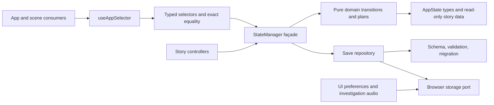

# Wave 2 module boundaries

This wave keeps `StateManager` as the public compatibility façade. Story controllers and UI continue to call its existing methods; the façade delegates state transitions and then owns notification, persistence scheduling, and event dispatch.

The domain layer has no dependency on `StateManager`, React, DOM APIs, or storage. A `DomainTransition` contains its resulting state, save policy, events, and public return value. Ordered `DomainPlan` steps are evaluated against the manager's current state one at a time. This preserves synchronous re-entry: if an event listener changes state while an earlier step is emitted, the next step is computed from that latest state instead of replacing it with a stale whole-state snapshot. The Act 2 bridge legacy-progress reconciliation uses this path for its existing Flag and note effects.

Selectors that return composed snapshots use a named comparator that checks each selected primitive or immutable domain reference. The reader integration test measures the actual memoized reader view function and its `act4NarrativeActionsSatisfied` calculation: a parent rerender and an unrelated desktop update keep both counts stable, while a reader-progress update increments them.

## Frozen equivalence evidence

The Act 1 EF trace test records and compares every event name and payload, in order, for the `PAGE_A1_E_001` then `PAGE_A1_E_002` controller path. Its frozen source is commit `f9e657463da076505796818262ff469f1641e541`; the expected trace was captured from that detached baseline worktree, not from the refactor.

The schema-9 school-completion migration fixture is the existing verified fixture from `src/core/saveManager.legacySchool.test.ts`. Its normalized schema-13 JSON SHA-256 from the same frozen commit is `ebaab26f996d7d447b4396ab21468cd5195a11c1e13f0afdcd00c876ccc27c58`. The compatibility test computes the hash with Web Crypto and asserts it. Supported input schema versions remain 1 through 13, including 7; the output remains schema 13.

The wave-2 targeted verification record is maintained in the delivery message. The full four-gate combination run and real-browser coverage remain with the parent final acceptance stage.
