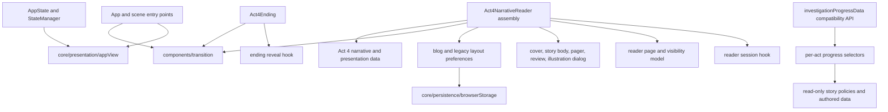

# Wave 3: presentation and reader boundaries

This wave keeps the existing React/TypeScript state and story contracts. It extracts presentation calculations and Act 4 reader pieces while preserving the public App, Reader, progress-selector, and serialized-save entry points. Story text, authored narrative data, flags, resources, CSS declarations, and existing tests are unchanged.

## Dependency direction

`deriveAppView` is a pure projection of `AppState` and App-owned display flags. It does not create a second route store; the first-act ending, scene takeover, Act 3 review, Act 4 overlay, dismissal, and desktop-label priorities remain in the same order.

`investigationProgressData.ts` re-exports the existing progress API and types. Its moved implementations are split by act in `data/investigationProgress/act1.ts` through `act4.ts`; `model.ts` combines those selectors and `desktopTasks.ts` retains desktop task derivation. A source audit compared every moved implementation block with the branch's frozen parent source; only `export` modifiers and imports changed. All current and future-stage visibility still comes from the existing authored state and policies.

The Act 4 Reader remains the single progression implementation. Its assembly delegates review-scroll/focus handling to `useAct4ReaderSession`, page rendering to the pager and story-body components, cover and illustration-dialog presentation to their components, recap rendering to `Act4ReaderReviewPanels`, and cover/action/page visibility to a pure selector. Saved reading positions continue through `uiPreferences`/`readingPosition`. Blog bookmarks and the layout-version migration keep their existing keys and validation, now resolve storage through `resolveBrowserStorage`; a storage failure leaves the current session usable. `advanceReaderStage` preserves the direct final T10 action and the existing transition for other stages.

`Act4Experience` and the compatibility `Act4LaterExperience` still use `Act4NarrativeReader`. The latter is referenced by its existing compatibility test and remains a thin wrapper; its old behavior is not maintained as a second reader.

## Shared transition behavior

App scene entry, Reader navigation, and Ending exits call the same `runSceneTransition` service. It uses the existing `sceneTransition` and `a4ReaderTransition` dataset hooks, tracks overlapping scopes by document root, and marks each update attempted before calling `flushSync`. A delayed or retained callback is therefore inert after a fallback commit, and an earlier completion cannot clear a newer same-scope transition.

Unsupported runtime, `file://`, reduced motion, missing APIs, and rejected browser transition promises use synchronous updates. Reader/Ending keep their existing arrival CSS scope for 260 ms when an API omits `finished`; the story action itself commits immediately. The fallback arrival class keeps its original 260 ms lifetime. The App layer keeps its 240 ms `ease-out` opacity animation. Existing focus restoration and reduced-motion behavior remain at their call sites.

Synchronous action exceptions propagate to the invoking event path. Rejected transition completions remain rejected for callers and are also sent to `globalThis.reportError` (or rethrown asynchronously where that hook is unavailable), so ignored event-handler promises do not silently discard an action failure. The transition tests cover absent runtime/API, `file://`, reduced motion, synchronous API throws, ready/finished rejection, retained callbacks, action exceptions, overlapping calls, nested calls, scope cleanup, and the 260 ms no-`finished` interval.

## Styles and preserved legacy paths

No CSS was moved. `App.tsx` still imports `styles.css`, `imageAssets.css`, and `components/sceneTransition.css` in their original order; `Act4NarrativeReader.tsx` still imports `act4/act4.css` at the same component boundary. These files contain interleaved global selectors, media rules, and overrides. Moving declarations into new files could change their cascade position, and this wave did not establish an expanded-CSS order equivalence proof. The private-blog stylesheet and all WeChat styles remain untouched. This is a deliberate preservation choice, not a claim that the styles have already been modularized.

## Adding a stage or reader action

1. Add the authored stage, text, page metadata, and required-action policy in the existing story/data locations under their normal content-review process; this wave does not edit those sources.
2. Keep page boundaries in `act4Presentation` and route the current Reader through its page model. Add any new cover, page, action, or explanation visibility condition to `readerVisibility` only when it represents display derivation; the state manager remains authoritative for progress and completion.
3. Put any stage transition behind the existing StateManager action and `advanceReaderStage`. Do not write a completion flag or advance a stage from a presentational component.
4. Add progress display derivation in the corresponding per-act progress module. Keep the original `investigationProgressData.ts` re-export surface stable and add focused tests for the new stage's current, completed, upcoming, and desktop-task views.
5. Keep preference reads and writes behind `resolveBrowserStorage`; preserve existing keys, fallback values, and schema contracts.
6. Add behavior tests for page bounds, review/focus restoration, action gating, or fallback storage as applicable. Do not alter frozen story fixtures or existing assertions to make the new path pass.

## Verification and limits

The directed wave-3 run passed 13 test files / 51 tests: shared transition behavior, App view priority, all existing investigation-progress cases, current and compatibility Act 4 Reader behavior, Ending reveal behavior, new Reader visibility/review-session/blog-preference behavior, real App rendering, progress-provider isolation, selector isolation, and legacy-save golden migration. `node node_modules/typescript/bin/tsc -b --pretty false` passed. The moved progress source audit passed against the frozen parent source.

This delivery does not claim the full four-gate suite, online/offline release build, browser smoke, remote CI, public-network performance, asset licensing audit, or commercial certification. The parent retains those final acceptance checks and the clean-source release procedure documented in [wave 1](./wave-1.md).
